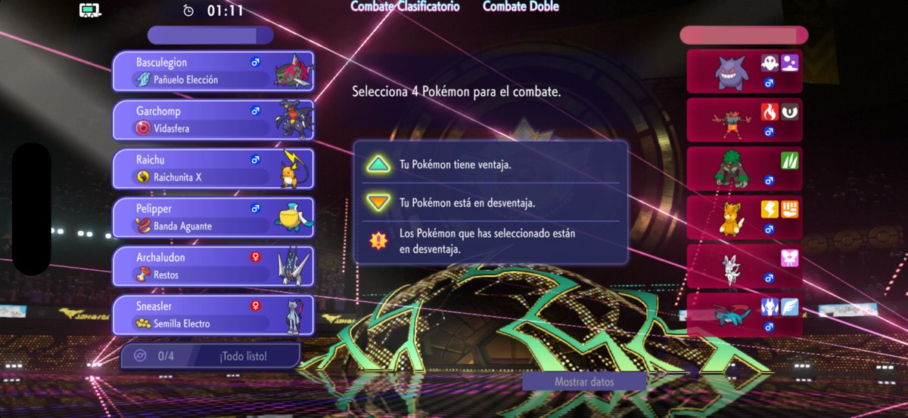
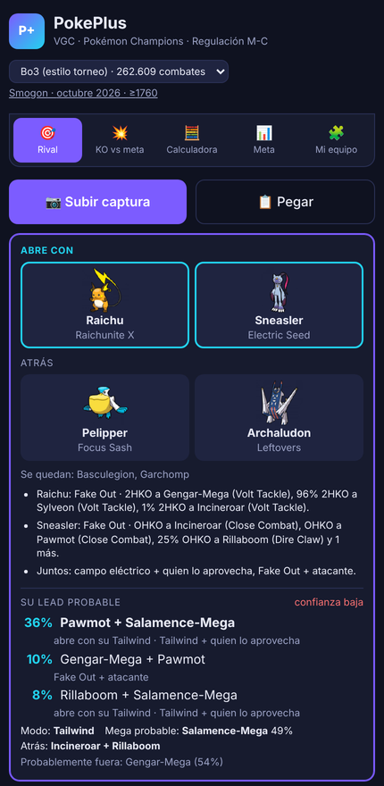
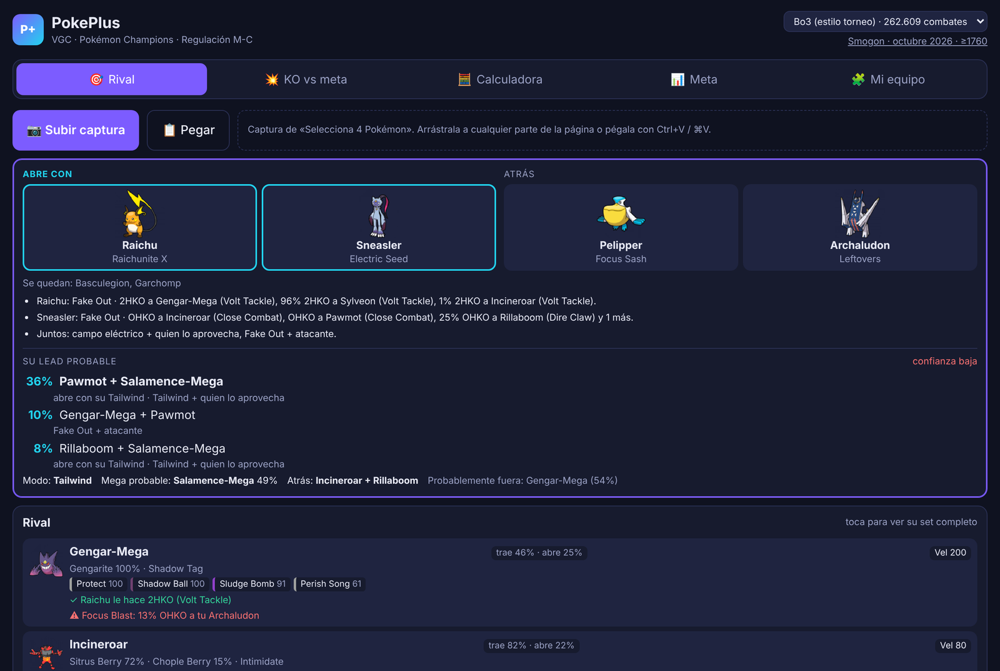

# PokePlus · asistente VGC para Pokémon Champions

**Sube la captura de la selección de equipo y en segundos te dice qué 4 llevar, con qué 2 abrir y qué es probable que haga el rival.** Pensado para usarlo desde el móvil durante los ~90 segundos de la previa del combate.

👉 **[pokeplus.vercel.app](https://pokeplus.vercel.app)**: gratis, sin registro. La captura se procesa en tu navegador y no se sube a ningún sitio.

<p align="center">
  
  
</p>
<p align="center"><em>De la captura del juego (izquierda) al plan de combate en el móvil (derecha).</em></p>

## Cómo se usa

1. **Guarda tu equipo** una vez en *Mi equipo* (pega el export de Showdown o una lista de nombres).
2. En la pantalla del juego *“Selecciona 4 Pokémon para el combate”*, haz una captura y **súbela, pégala o arrástrala** en la pestaña *Rival*.
3. Lee el plan: **Abre con** (tu lead), **Atrás** (los otros 2), la **lead probable del rival** y, para cada uno de sus Pokémon, sus movimientos, objetos y velocidad más habituales.

Si la app no está segura de algún Pokémon u objeto lo marca como *dudoso* para que lo corrijas con un toque.



## Qué hace

- **Rival**: sube o pega una captura de la pantalla de selección de equipo: se reconocen los 6 del rival (sprite, tipos y sexo) y tus 6 con su objeto, y arriba sale qué 4 llevar y con qué 2 abrir. Para cada rival muestra de un vistazo sus
  movimientos, objetos, habilidades y repartos de Stat Points más usados, con % reales, su velocidad y la probabilidad
  de cada forma Mega. Si has guardado tu equipo, recomienda **qué 4 llevar y la lead**, predice la lead del rival y
  muestra una matriz de enfrentamientos (quién hace OHKO/2HKO a quién y quién es más rápido). Sin equipo, sugiere
  Pokémon del meta que le ganan a ese equipo.
- **KO vs meta**: a qué Pokémon del top del meta haces OHKO/2HKO con cada ataque, o al revés, qué amenazas te los hacen a ti.
- **Calculadora**: calculadora de daño y stats completa (SP, naturaleza, objeto, habilidad, boosts, clima, campo,
  pantallas, Refuerzo, críticos, ataques de área).
- **Meta**: ranking de uso con el detalle de cada Pokémon (compañeros y checks/counters incluidos).
- **Mi equipo**: importa/exporta en formato Showdown o con una lista de nombres.

## De dónde salen los datos

- Estadísticas de uso reales de [Smogon](https://www.smogon.com/stats/) (Pokémon Showdown), formato
  `gen9championsvgc<año>reg<x>` (Bo3 y ladder, rating ≥1760). `scripts/fetch-usage.mjs` detecta el mes y la regulación
  más recientes y genera `public/data/usage.json`.
- Se actualizan solas: en cada build de Vercel y con la GitHub Action `update-usage.yml` (los primeros días de cada mes).
- Daño con [`@smogon/calc`](https://github.com/smogon/damage-calc), el mismo motor que la calculadora de Showdown, con
  las mecánicas de Champions (nivel 50, 32 SP por stat, 66 en total, Megas).
- La recomendación de lead es una heurística: combina los cálculos de daño contra los sets más usados del rival,
  velocidad, roles (Fake Out, Tailwind, Trick Room, redirección, clima, Intimidación) y el uso real.

## Desarrollo

```bash
npm install
npm run data   # descarga las estadísticas más recientes
npm run dev
npm test
```

## Reconocimiento de capturas

En la pantalla “Selecciona 4 Pokémon para el combate” el juego no muestra los nombres del rival, solo su sprite, sus
iconos de tipo y su sexo; tu columna muestra tu sprite y el icono de tu objeto. `src/lib/vision.ts` localiza las
tarjetas rojas (rival) y moradas (tuyas), lee el color de los iconos de tipo y el símbolo de sexo y compara el sprite,
que el juego dibuja siempre en la misma posición de la tarjeta, con cada sprite de menú del juego (atlas
`public/data/sprites.png`, 40×40) con una holgura de ±2 píxeles. Los objetos se comparan igual contra
`public/data/items.png` (24×24); una megapiedra solo se acepta si es de ese Pokémon. Todo ocurre en el navegador; la
imagen no se sube a ningún sitio.

Si ningún candidato encaja bien (tarjeta desplazada por compresión, reescalado u otra pantalla), se busca el
desplazamiento en un margen más amplio, y la lectura se marca como dudosa si sigue sin encajar o si los tipos leídos no
son los de la especie elegida.

Pruebas:

- `tests/vision.test.ts`: tres capturas reales (tal como las decodifica el navegador y sin convertir el color P3).
- `tests/roster.test.ts`: capturas sintéticas (`tests/synth.ts`) con los 270 Pokémon y los 166 objetos en todos los
  huecos, y muestras con JPEG, Switch y baja resolución.
- `MATRIX=1 npx vitest run tests/matrix.test.ts`: matriz completa (9 variantes de dispositivo, ~7 min).
- `tests/data.test.ts`: cada especie de las estadísticas existe en el calc y tiene sprite.

Las hojas de sprites originales para las pruebas se regeneran con
`node scripts/build-test-roster.mjs /tmp/champ-sprites`.

Para regenerar los atlas (p. ej. si llegan Pokémon nuevos con una regulación):

```bash
git clone --depth 1 https://github.com/KevinToodlepoot/pokemon-champions-sprites /tmp/champ-sprites
npm run sprites -- /tmp/champ-sprites
```

## Aviso

Proyecto de fans sin ánimo de lucro, sin relación con Nintendo, Game Freak, Creatures ni The Pokémon Company. Pokémon y sus nombres son marcas de sus respectivos dueños. Los sprites proceden de [KevinToodlepoot/pokemon-champions-sprites](https://github.com/KevinToodlepoot/pokemon-champions-sprites) y las estadísticas de uso de Smogon.
